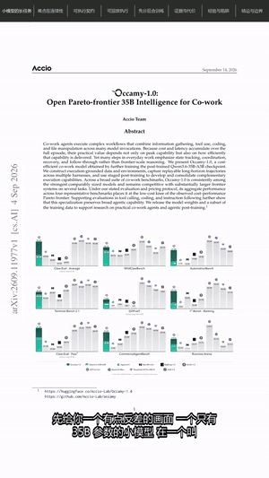
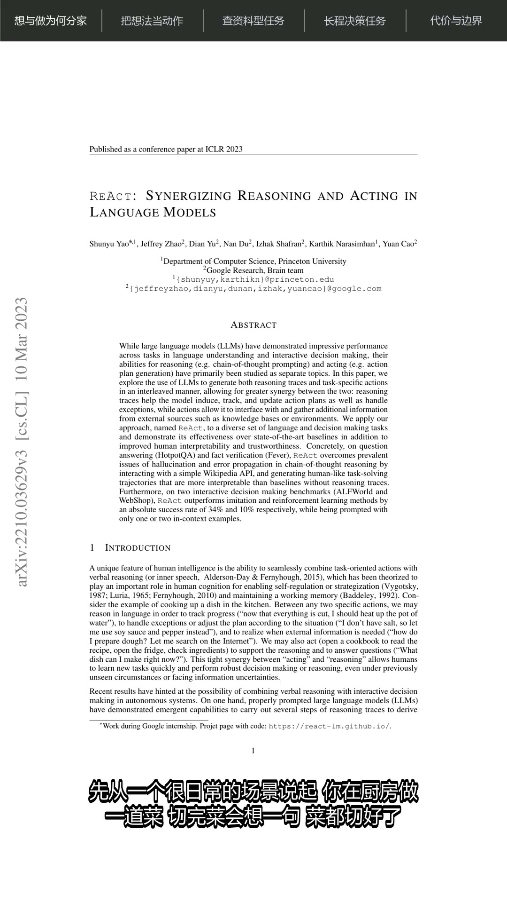
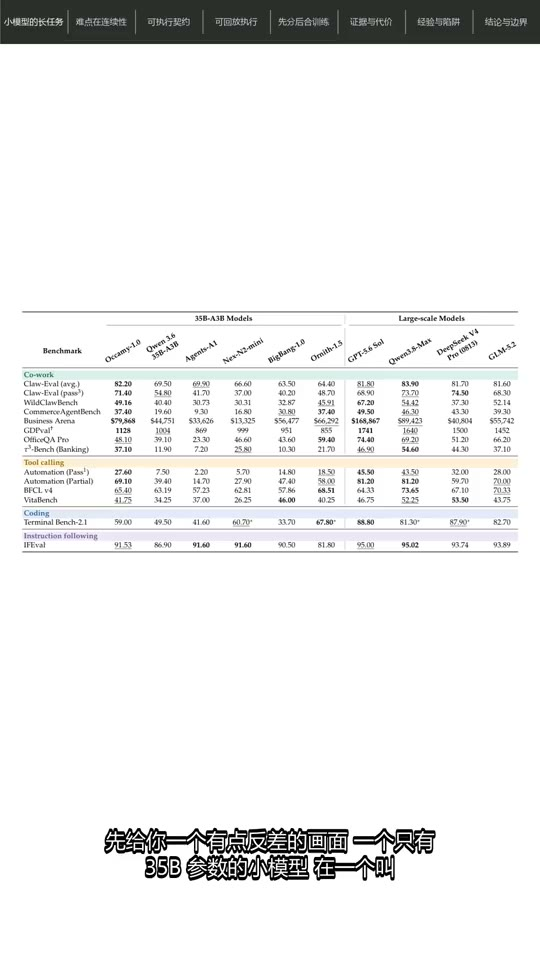
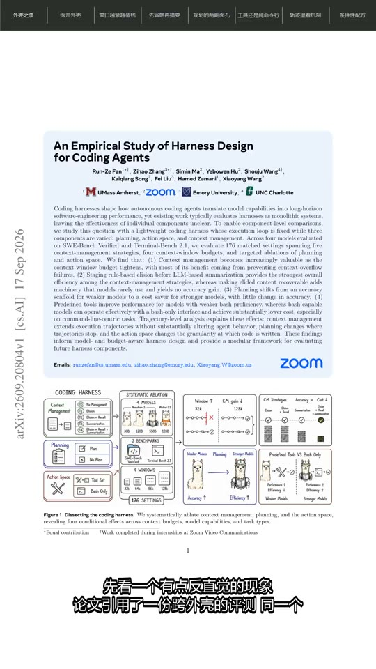
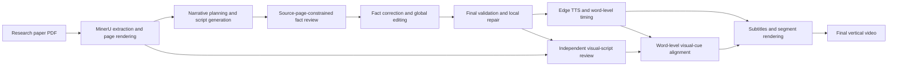

<div align="center">

# Paper Video Agent

**Turn research-paper PDFs into source-grounded Chinese vertical explainer videos.**

**English** | [简体中文](README.md)

[](https://github.com/QXP1997/paper_video_agent/actions/workflows/ci.yml)
[](https://www.python.org/)
[](https://github.com/QXP1997/paper_video_agent/tags)
[](LICENSE)

> It does not merely read a paper aloud. It tries to explain it clearly.

<a href="https://www.bilibili.com/video/BV1omeb6aE4z/">
  
</a>

<sub>Full-page narration, figure-aware focus, Chinese voice-over, and subtitles. Click to watch the full video.</sub>

</div>

Paper Video Agent takes a research-paper PDF through structured extraction, narrative planning,
source-page-constrained fact review, speech synthesis, subtitle generation, visual timing, and video
composition. The result is a publishable `9:16` Chinese explainer video rather than a text-only summary.

```text
Paper PDF → structured parsing → narrative and script → fact review
          → voice and subtitles → figure-aware focus → MP4
```

> The current release is `0.2.0` (Beta). It is intended for research demos and content creation.
> Generated content must still be checked against the original paper before publication.

## Why this project

- **End-to-end output**: produces a high-quality master video and a compressed social-media version.
- **Grounded and inspectable**: reviews each chapter against its planned source pages and keeps scripts,
  review results, validation records, and the visual timeline.
- **Figure-aware narration**: normally shows the full PDF page and focuses on a figure, table, equation,
  or titled code block only when the narration discusses it.
- **Built for iteration**: caches parsing, scripts, audio, review results, and rendered segments so a local
  change does not require a full rerun.
- **Low model cost**: the author's DeepSeek Flash runs have used less than `¥1` in LLM calls per complete
  video. Actual cost depends on paper length, provider pricing, and retries.

## Demo videos

Click a thumbnail to watch the complete video on Bilibili.

<table>
  <tr>
    <td align="center" width="33%">
      <a href="https://www.bilibili.com/video/BV1oXhy6YEK4/">
        
      </a>
    </td>
    <td align="center" width="33%">
      <a href="https://www.bilibili.com/video/BV1omeb6aE4z/">
        
      </a>
    </td>
    <td align="center" width="33%">
      <a href="https://www.bilibili.com/video/BV1CBeh67EiE/">
        
      </a>
    </td>
  </tr>
  <tr>
    <td align="center"><strong>ReAct: reasoning and acting</strong></td>
    <td align="center"><strong>How a 35B model handles long tasks</strong></td>
    <td align="center"><strong>How much does the agent harness matter?</strong></td>
  </tr>
</table>

## Pipeline



## Requirements

- Python 3.11 or later; currently tested on Python 3.12
- [FFmpeg](https://ffmpeg.org/) and `ffprobe` available on `PATH`
- Network access to MinerU, DeepSeek, and Edge TTS
- A font with Chinese glyph coverage

FFmpeg must include the `drawtext` and `subtitles` (`libass`) filters:

```bash
ffmpeg -version
ffprobe -version
ffmpeg -filters
```

## Installation

```bash
git clone https://github.com/QXP1997/paper_video_agent.git
cd paper_video_agent
python -m venv .venv
```

Windows PowerShell:

```powershell
.\.venv\Scripts\Activate.ps1
python -m pip install --upgrade pip
python -m pip install -e .
Copy-Item .env.example .env
```

macOS/Linux:

```bash
source .venv/bin/activate
python -m pip install --upgrade pip
python -m pip install -e .
cp .env.example .env
```

Set at least the DeepSeek and MinerU credentials in `.env`:

```dotenv
DEEPSEEK_API_KEY=your_deepseek_api_key
DEEPSEEK_BASE_URL=https://api.deepseek.com
DEEPSEEK_MODEL=deepseek-flash
MINERU_API_KEY=your_mineru_api_key
```

The `.env` file is ignored by Git. Never put real API keys in the README, issues, logs, or commit history.

## Usage

Generate a complete video:

```bash
python -m paper_video_agent --pdf "/path/to/paper.pdf"
```

By default, the program creates a `<PDF-name>_output` working directory beside the source PDF. To use
an explicit working directory:

```bash
python -m paper_video_agent \
  --pdf "/path/to/paper.pdf" \
  --paper-dir "/path/to/workdir"
```

Render previews for selected segments only:

```bash
python -m paper_video_agent \
  --pdf "/path/to/paper.pdf" \
  --paper-dir "/path/to/workdir" \
  --preview-segments 3 8 12
```

Generate social-media titles, descriptions, and tags from the final script:

```bash
python -m paper_video_agent.social_metadata \
  --script-json "/path/to/workdir/output/paper_script.final.json"
```

Installed console commands are also available:

```bash
paper-video --help
paper-video-metadata --help
```

If Windows blocks an unsigned `pip`-generated launcher, use the `python -m` forms above.

## Output artifacts

```text
<workdir>/
├── audio/                         # TTS audio and word-level timing manifests
├── images/                        # Rendered PDF pages
├── subtitles/                     # Segment-level SRT files
└── output/
    ├── mineru/                    # Extracted raw MinerU result
    ├── mineru_parse.json          # Parsed pages, visuals, and source-PDF fingerprint
    ├── focus_assets/              # Visual inventory and cropped focus assets
    ├── segments/                  # Rendered segments and input-fingerprint caches
    ├── paper_script.json          # Original narrative plan and narration
    ├── script_audit.json          # Source-page-constrained fact review
    ├── paper_script.edited.json   # Corrected and globally edited candidate
    ├── script_validation.json     # Deterministic validation and repair record
    ├── paper_script.final.json    # Validated script used by TTS and rendering
    ├── visual_review.json         # Independent visual-script review
    ├── visual_timeline.json       # Visual switches aligned to word timestamps
    ├── social_metadata.json       # Structured publishing metadata
    ├── social_metadata.md         # Editable publishing copy
    ├── final.mp4                  # High-quality master
    └── final_social.mp4           # Compressed social-media version
```

## Technical behavior

### Grounded script review

Each chapter is reviewed strictly against its planned `source_pages`. The reviewer receives the complete
chapter narration and the parsed text of those pages; it does not search or guess from unrelated pages.
Unsupported claims are recorded in `script_audit.json`.

The editing stage reads the complete original script and the audit result without overwriting
`paper_script.json`. It corrects factual problems, cross-chapter repetition, number-heavy passages, and
spoken-language issues, producing `paper_script.edited.json`.

Final validation combines deterministic checks with limited model-based repair. It checks chapter
structure, page ranges, repeated passages, unsupported new numbers, overly long segments, and unresolved
high-risk audit findings. Only structural errors, illegal pages, new numbers, and high-risk factual issues
can block generation after at most two local repair rounds.

### Figure-aware visual timing

The default visual is the complete PDF page. A separate visual-review stage decides whether a narration
segment actually discusses a specific figure, table, equation, or titled code block. Valid cues are aligned
to Edge TTS word timestamps; unreliable or overlapping cues safely fall back to the full page.

Adjacent focus intervals that use the same asset and are separated by no more than five seconds are merged
to avoid distracting page-to-asset flicker. Configure the threshold with
`PAPER_VIDEO_VISUAL_MERGE_GAP_SECONDS`; set it to `0` to merge only touching intervals.

### Caching and partial reruns

Existing artifacts are reused when their input fingerprints still match. Changes to paper contents, script
prompts, script schema, or model configuration invalidate the script stages. TTS and rendering settings do
not invalidate the paper script. Visual-cue or rendering changes invalidate only affected video segments,
not TTS output.

## Configuration

All values can be placed in the project-root `.env` file or exported as environment variables.

| Variable | Default | Purpose |
| --- | --- | --- |
| `DEEPSEEK_API_KEY` | none | DeepSeek API key |
| `DEEPSEEK_BASE_URL` | `https://api.deepseek.com` | OpenAI-compatible base URL |
| `DEEPSEEK_MODEL` | `deepseek-flash` | Model name |
| `MINERU_API_KEY` | none | MinerU API token; keep it only in local `.env` |
| `PAPER_VIDEO_TTS_VOICE` | `zh-CN-XiaoxiaoNeural` | Edge TTS voice |
| `PAPER_VIDEO_TTS_RATE` | `+25%` | Speech rate |
| `PAPER_VIDEO_TTS_PITCH` | `+0Hz` | Speech pitch |
| `PAPER_VIDEO_TTS_CONCURRENCY` | `4` | Concurrent TTS jobs |
| `PAPER_VIDEO_VIDEO_CONCURRENCY` | `3` | Concurrent video-render jobs |
| `PAPER_VIDEO_VISUAL_MERGE_GAP_SECONDS` | `5` | Maximum gap when merging the same visual asset |
| `PAPER_VIDEO_FONT_NAME` | platform-specific | FFmpeg Chinese font family |
| `PAPER_VIDEO_FONT_PATH` | none | Absolute font path; takes priority over the family name |

Windows automatically tries Microsoft YaHei. On macOS/Linux, install Noto Sans CJK and configure its
actual family name or path.

## Development

```bash
python -m pip install -e ".[dev]"
ruff check .
pytest
```

See [CONTRIBUTING.md](CONTRIBUTING.md) for the contribution workflow and [SECURITY.md](SECURITY.md) for
security reporting.

## Known limitations

- LLM output may contain factual errors, omissions, or inaccurate references. Review against the paper.
- MinerU may need manual correction for complex multi-column layouts, scans, equations, and tables.
- Full generation calls third-party services and may incur API charges.
- Rendering speed and memory usage depend on page count, resolution, and concurrency.
- The current pipeline primarily produces Chinese `9:16` vertical videos and does not yet expose a full
  style-customization interface.

## Content and privacy

Before uploading a paper to external model services, confirm that its content and attachments may be
processed that way. Do not process personal data, confidential information, or restricted documents.
Users are responsible for the copyright and platform compliance of papers, figures, fonts, voices, and
generated videos.

## License

[MIT](LICENSE)
